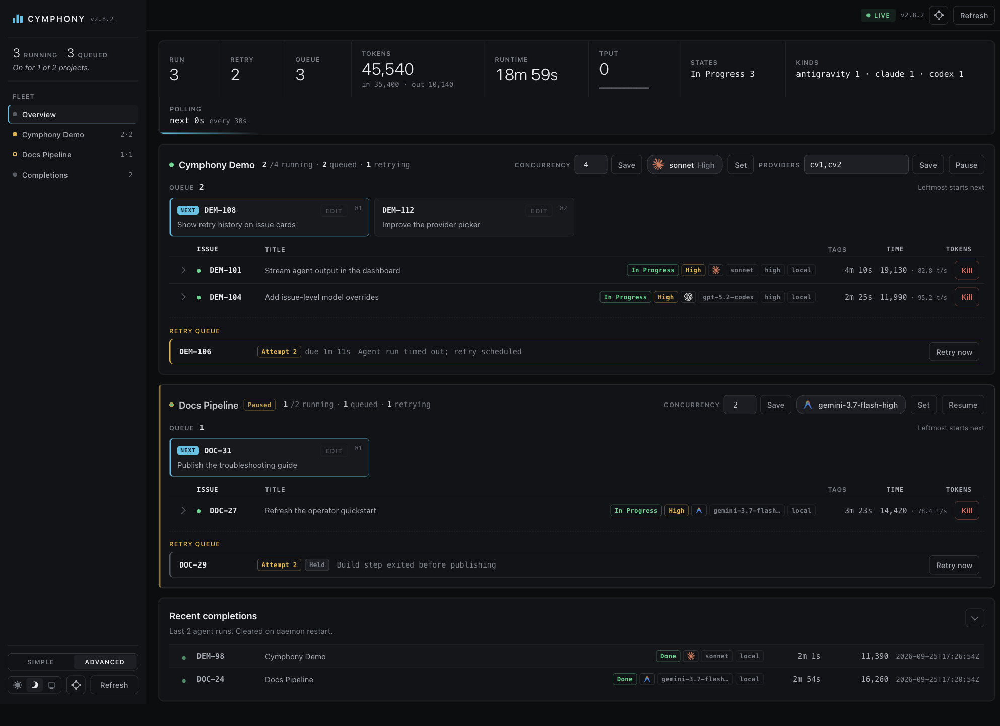
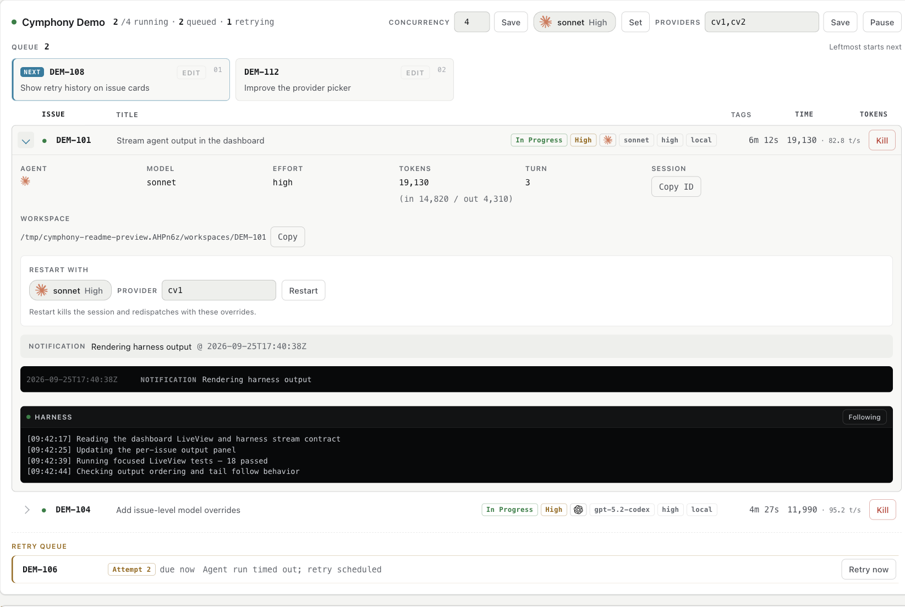

# Cymphony

Cymphony is a self-hosted Elixir/OTP service that turns Linear issues into supervised coding-agent sessions. It polls Linear, creates an isolated workspace for each issue, runs the selected harness, streams progress to a dashboard, and retries or cleans up work as the issue changes state.

Cymphony is **not tied to one coding agent**. The current built-in harnesses are:

| Harness | Command | Model picker / effort | Provider environment |
|---|---|---|---|
| Claude Code | `claude` | `sonnet`, `opus`, `haiku`; effort is passed through | `ANTHROPIC_*`, `CLAUDE_CODE_*`, `API_TIMEOUT`; fallback `ANTHROPIC_API_KEY` |
| Codex CLI | `codex` | live `codex debug models` catalog (bundled/static fallback); per-model reasoning levels | `OPENAI_*`, `CODEX_*`, `API_TIMEOUT`; fallback `OPENAI_API_KEY` |
| Antigravity CLI | `agy` | static catalog of Gemini/CLI-Proxy slugs such as `gemini-3.7-flash-high`; reasoning is encoded in the slug | `ANTIGRAVITY_*`, `GOOGLE_*`, `GEMINI_*`, `API_TIMEOUT`; fallback `GOOGLE_API_KEY` or `GEMINI_API_KEY` |

These are the supported kinds returned by `CymphonyElixir.Agent.known_kinds/0`: `claude`, `codex`, and `antigravity`. Other harnesses are not silently treated as supported. Model names shown here and below are examples from the source catalog, not a guarantee that a particular installed CLI or provider accepts them. A named provider is only selected for the matching harness; without one, the selected harness may use its normal inherited fallback credentials. Public dashboard/API projections and failure excerpts redact recognized secrets, but the **host-local debug transcript intentionally retains raw agent output** and may contain credentials.

> **Preview software:** run it only against repositories and credentials you trust. An agent can edit code, run commands, and push branches according to your workflow.

**Release status (2026-09-25):** This README describes current `main`. The latest published package is v2.8.2 (2026-08-18); it predates the unreleased hardening and behavior documented here, although `main` still reports version `2.8.2`. Build from source for current-`main` behavior; do not assume the published v2.8.2 binaries include it.

## What it does

- Watches one or many Linear projects in one daemon.
- Dispatches active issues into persistent, per-issue workspaces under the configured workspace root.
- Runs Claude Code, Codex CLI, or Antigravity CLI through one normalized agent interface.
- Supports per-project defaults and per-issue overrides from queue pins, Linear labels, or a `cymphony:` description directive.
- Resumes an active issue in the same workspace and agent session for continuation turns (up to `agent.max_turns`).
- Retries failed or stalled runs with backoff; after the configured consecutive-failure budget is exceeded, comments on the issue, optionally moves it to `agent.failure_state`, and cleans up.
- Provides a Phoenix LiveView dashboard, terminal status dashboard, JSON API, live harness stdout, pause/resume, kill/retry, concurrency controls, and recent completion history.
- Supports optional SSH workers, worker capacity limits, lifecycle hooks, retention sweeps, and local Linear MCP integration for Claude Code and Codex.
- Stores runtime project configuration in `~/.cymphony/config.json` and generates owner-only (`0600`) per-project `WORKFLOW.md` files.

## Screenshots

Captured **2026-09-25** from application source `2cdd8e3` in ego lite. These are real dashboard renders with **fictional example data**, not production activity, performance benchmarks, or provider/model availability claims. Subsequent test/documentation updates do not change the pictured UI.

**Advanced overview — dark theme:** multi-project queues, three harnesses, concurrency controls, retry/held state, and completions.



<details>
<summary>Expanded session and live harness output — light theme</summary>



</details>

[Capture provenance](.github/media/README.md). The UI still displays the source version `2.8.2`; these screenshots include unreleased `main` changes, not just the published v2.8.2 binary.

## Install

### macOS — Homebrew

```bash
brew tap zaalipro/cymphony

# Bundled Erlang/Elixir runtime
brew install cymphony

# Or a smaller binary using your existing Homebrew runtime
brew install cymphony-lite
```

The formulas conflict; choose one. Uninstalling or switching formulas does not remove `~/.cymphony` or your workspaces.

### Ubuntu / Debian

Download the latest `.deb` from [GitHub Releases](https://github.com/zaalipro/cymphony/releases):

```bash
wget https://github.com/zaalipro/cymphony/releases/latest/download/cymphony_2.8.2_amd64.deb
sudo dpkg -i cymphony_2.8.2_amd64.deb
```

The package bundles the Erlang VM. Install the harnesses you plan to use separately and put them on `PATH` (`claude`, `codex`, and/or `agy`).

### From source

```bash
git clone https://github.com/zaalipro/cymphony
cd cymphony
mise trust && mise install
mix setup
make build
./bin/cymphony port 4089
```

The repository pins Elixir `1.19.5-otp-28` and Erlang `28.4.2` through mise.

## First run

Run the wizard:

```bash
cymphony                 # starts setup when ~/.cymphony/config.json is absent
cymphony setup            # run it again
cymphony add              # add one project later
```

The wizard collects a project name, Git URL, Linear project slug and API key, workspace root, polling interval, harness kind, model, effort, and an optional provider. `LINEAR_API_KEY` is accepted as a fallback/default, but the wizard persists the key in `~/.cymphony/config.json` with mode `0600`.

A configured project is represented by a flat entry in `config.json`; at startup Cymphony converts it into a validated workflow and writes a temporary per-project `WORKFLOW.md`. The generated workflow contains tracker, polling, workspace, agent-kind sections, and optional hooks. Do not put personal keys in the committed `WORKFLOW.md` in this repository.

For a hand-authored single-project workflow, pass its path directly (`cymphony /path/to/WORKFLOW.md`, or `cymphony WORKFLOW.md` in that directory). This legacy mode starts one supervised global `WorkflowStore` and `Orchestrator` after the application boots; an invalid workflow fails startup rather than leaving a daemon that only appears to be running. Starting again with the same path is a no-op; selecting a different path while that runtime is active returns an error instead of silently replacing its workflow. Configured multi-project mode starts only named project runtimes, not an extra global orchestrator.

## Running Cymphony

```bash
cymphony port 4089                         # foreground daemon + dashboard
cymphony start                             # background daemon
cymphony stop
cymphony restart
cymphony logs 100                           # recent log lines
cymphony webui                              # open the recorded dashboard URL
cymphony list
cymphony v
```

Useful shorthand and long-form flags:

```bash
cymphony project MyApp                     # only one configured project
cymphony cr 3                               # concurrency cap
cymphony agent codex                        # select a harness
cymphony agent antigravity
cymphony model opus effort high
cymphony c cv1,cz                           # rotate named providers
cymphony project MyApp cr 5 c cv1,cz port 4089
```

Long forms include `--project`, `--agent`, `--model`, `--effort`, `--concurrency`, `--provider`, `--port`, `--logs-root`, `--setup`, `--help`, and `--version`.

Without `port`, the orchestrator can run headlessly. With a port, the dashboard is available at `http://localhost:<port>/`; the default bind host is local-only. Set `CYMPHONY_API_TOKEN` before starting if the dashboard/API must require bearer authentication. Browser access can use `?token=...` once; API clients should send `Authorization: Bearer ...`.

## Choosing a harness and run spec

Set project defaults in the wizard, dashboard, API, or `config.json`:

```json
{
  "projects": [
    {
      "name": "MyApp",
      "github_repo_url": "git@github.com:you/myapp.git",
      "linear_project_slug": "myteam-ab12cd34ef56",
      "workspace_root": "~/.cymphony/workspaces/MyApp",
      "agent": "codex",
      "model": "gpt-5.2-codex",
      "effort": "high",
      "providers": ["codex_work"]
    }
  ]
}
```

At dispatch time, `agent`, `model`, and `effort` are resolved independently in this order for a waiting queue card:

1. A saved queue-card pin (`agent_kind`, `model`, or `effort`), if present.
2. Linear labels: `agent:<kind>`, `model:<name>`, `effort:<level>`.
3. The first matching directive line in the description, for example:
   `cymphony: agent=antigravity model=gemini-3.7-flash-high`.
4. The project configuration/defaults.

Provider selection has no queue-card pin: an explicit per-session provider override wins, then a `provider:<alias>` label, a description directive, and finally rotation from the selected kind's project provider list. A running-session restart override can supersede queue pins; pins win for ordinary waiting-card dispatch. An unknown agent kind is ignored and falls back to the next source. The resolved spec is pinned for that run attempt; changing configuration does not mutate an already-running session.

Antigravity does not receive `--effort`: its model slug carries the reasoning level. Codex uses `-c model_reasoning_effort=...`; Claude receives `--effort` when supplied.

## Providers

A provider is a named environment switch, not a second harness. Define a top-level `providers` environment map in `~/.cymphony/config.json`, or define a shell function in `~/.cld`, `~/.zshrc`, or `~/.bashrc`. A config-map entry takes precedence; both forms filter values to the active harness's environment prefixes. Shell aliases must be safe function identifiers (`[A-Za-z_][A-Za-z0-9_]*`); they **do not** need to start with `c`. The auto-discovery list shown by onboarding is narrower and lists lowercase `c…` functions only. Shell functions run in a zsh subprocess and their filtered results are cached for the daemon lifetime.

Example top-level config-map entry (merge alongside `projects`):

```json
{
  "providers": {
    "codex_work": {"OPENAI_API_KEY": "<secret>", "OPENAI_BASE_URL": "https://api.example.test/v1"}
  }
}
```

The real config file contains secrets; keep it private (`0600`).

Example `~/.cld`:

```bash
_unset() {
  unset ANTHROPIC_BASE_URL ANTHROPIC_API_KEY ANTHROPIC_MODEL ANTHROPIC_AUTH_TOKEN
  unset OPENAI_API_KEY OPENAI_BASE_URL CODEX_API_KEY
  unset ANTIGRAVITY_API_KEY GOOGLE_API_KEY GEMINI_API_KEY
}

cz() { _unset; export ANTHROPIC_BASE_URL=https://api.z.ai/api/anthropic; export ANTHROPIC_API_KEY=sk-...; }
co() { _unset; export OPENAI_API_KEY=sk-...; export OPENAI_BASE_URL=https://api.example.test/v1; }
ag() { _unset; export GEMINI_API_KEY=...; }
```

Use one provider for all sessions or rotate a comma-separated list:

```bash
cymphony c cz
cymphony c co,cz
```

For Claude, the dashboard exposes project/session provider fields. They are hidden for Codex and Antigravity because the dashboard's provider editor is Claude-compatible-provider specific; existing provider data is retained when the kind is changed. A provider change applies to a new dispatch (a per-session provider change restarts that session).

## Dashboard

Start with `cymphony port 4089`. The LiveView dashboard has Simple and Advanced modes (the selection is browser-local).

- The command bar shows runtime, usage, working/waiting/retry counts, and—in Advanced mode—throughput, polling, rate limits, and token details.
- Each project has durable pause/resume, concurrency, a harness/model/effort switcher, Claude-only provider controls, and counts in the form `N/M running · Q queued · R retrying`.
- **Queue board** appears above In Progress. It contains eligible waiting issues that are not running or retrying. Dragging persists operator order in `queue_order`; queue pins persist agent/model/effort in `queue_pins`. Cymphony rank is the row-major queue index, not Linear priority. Queue-card edits do not kill a run or write to Linear.
- Expanded sessions include live `HarnessStream` stdout with Follow/Paused controls, runtime, workspace/worker/log data, and restart overrides. Agent kinds are shown with icons.
- Retry remains below In Progress. A manual retry is an explicit override, including while paused. Automatic retries use backoff and preserve failure context; a timer due during pause is held without consuming another attempt, then released immediately on resume.
- Recent completions are persisted in `~/.cymphony/sessions.db` (up to 100 per project in the dashboard; the API supports larger bounded queries).
- Settings provides Linear connect, searchable Linear-project add, project defaults, pause/concurrency controls, display visibility, and dashboard payload refresh seconds (default `3`, minimum `1`). Dashboard refresh is separate from the Linear polling interval.

Linear connect and add-project never expose the raw API key. `linear_api_key`, queue state, pause state, agent settings, and dashboard refresh seconds are persisted atomically in `~/.cymphony/config.json` with mode `0600`.

## HTTP API

All routes are under `/api/v1/` and require `?project=...` where shown. Successful mutations generally return `202`; invalid input returns `422`; unsupported methods return `405`.

| Method | Path | Purpose |
|---|---|---|
| `GET` | `/state` | Full orchestrator snapshot, including waiting, running, retrying and counts |
| `GET` | `/projects` | Configured/running project summary; `503 snapshot_unavailable` if projects exist but none can answer, versus `200 {"projects":[]}` for a truly empty fleet |
| `POST` | `/projects` | Add and start a project without daemon restart |
| `GET` / `POST` | `/linear` | Inspect Linear connection / validate and persist API key |
| `GET` | `/linear/projects` | List accessible Linear projects after connecting |
| `POST` | `/refresh` | Force a Linear poll (not dashboard refresh) |
| `POST` | `/refresh-interval` | Persist dashboard payload seconds: `{"value": 3}` |
| `POST` | `/pause` / `/resume` | Durable dispatch pause state, optionally `?project=Name` |
| `POST` | `/concurrency` | Set a positive concurrency value, optionally by project |
| `POST` | `/providers` | Set a non-empty provider CSV, optionally by project |
| `POST` | `/agent` | Set `kind`, `model`, and/or `effort`; known kinds are enforced |
| `POST` | `/queue` | Persist waiting order; requires `?project=Name` and `{"order":[...]}` |
| `POST` | `/queue-pin` | Pin waiting issue run fields; requires project and issue; does not kill |
| `GET` | `/<issue_identifier>` | Running issue details; use `?project=` when identifiers overlap |
| `GET` | `/<issue_identifier>/harness` | Live harness stdout ring |
| `GET` | `/completed?limit=N` | Recent durable completion records (limit capped at 1000) |

If `CYMPHONY_API_TOKEN` is set, send `Authorization: Bearer <token>` to API calls. `POST /linear` validates the key with Linear and never echoes it.
Control mutations return `422` rather than claiming success if an in-memory change could not be saved; the error message says the change was applied but is not durable. A failed Linear workflow rewrite or new-project workflow generation also returns `422` after the key/project was saved. Retry after correcting the filesystem or configuration. Provider aliases must be safe shell-function names; malformed aliases and non-string provider lists are rejected.

## Workflow configuration

`WORKFLOW.md` front matter is parsed and validated into the runtime schema. The generated config uses these top-level sections:

- `tracker`: Linear endpoint/key, project slug, active and terminal states.
- `polling`: positive `interval_ms`.
- `workspace`: root and optional `retention_days`.
- `agent`: `kind`, model/effort, concurrency, turn/retry/stall limits, optional failure state.
- `claude`, `codex`, `antigravity`: command, output format, sandbox/permission settings, providers, and per-kind extra args.
- `hooks`: `after_create`, `before_run`, `after_run`, `before_remove`, and a positive hook timeout.
- `worker`: optional SSH hosts and per-host concurrency.
- `observability`/`server`: dashboard, refresh, host, port, and snapshot settings.

Agent and hook commands run inside the issue workspace. Workspace paths are checked for safety; the source repository is never used as a coding-agent turn directory. Workspace cleanup runs when an issue reaches a terminal state or is abandoned, and retention sweeps remove old idle workspaces.

### Linear MCP

For local sessions with a Linear key, Cymphony offers the `cymphony-linear` MCP server to Claude Code and Codex. Claude receives a workspace `.cymphony/mcp_config.json` descriptor (mode `0600`); Codex receives CLI config overrides that inherit `LINEAR_API_KEY` from its process environment. Neither puts the key on the command line. Remote SSH sessions do not inject the local MCP descriptor.

## Retry, continuation, and safety behavior

- A normal turn that leaves the issue active causes a continuation turn in the same agent session; the runner re-fetches issue state before continuing.
- An agent failure retries after exponential backoff starting at 10 seconds, capped by `agent.max_retry_backoff_ms` (default 300 seconds). A continuation retry uses a 1-second delay.
- The stall watchdog defaults to 5 minutes of agent-event silence and is configurable per project with positive `agent.stall_timeout_ms`.
- In `config.json`, `stall_timeout_ms` is a positive-integer project key; invalid/nonpositive values fall back to 5 minutes. Operator-authored `extra_args` can be a string list or a map of per-kind string lists, and only the active kind is emitted into generated workflow front matter. Antigravity defaults to `--new-project` and writes its CLI log beside the workspace; only an explicit project `new_project: false` removes that flag.
- Per-project `config.json` keys `claude_bare_mode` (boolean, absent = `true`/`--bare`; `false` drops `--bare`) and `max_retry_backoff_ms` (positive integer, absent = 300000) are generated into `claude.bare_mode` and `agent.max_retry_backoff_ms`; they persist across saves and workflow regeneration. Invalid saved values are rejected by `Config.update_agent_settings/2`.
- Genuine consecutive failures count toward `agent.max_retry_attempts` (default 30). Once that budget is exceeded, Cymphony posts a bounded/redacted error comment, optionally changes state, and removes the workspace. A pause-held retry keeps its attempt/failure count; an explicit manual retry remains available while paused.
- Terminal or non-active issues stop running agents. Terminal cleanup runs `before_remove` before deletion. Manual kill stops the session without deleting the workspace.
- Workspace and harness output is streamed into bounded buffers; recognized secrets are redacted from public event state, harness views, and failure excerpts. This is not a general secret scanner: unnamed values without a known pattern may pass through. A single unterminated CLI line above 256 KiB is rejected; the Antigravity fallback text window is capped at 64 KiB with a truncation marker. The host-local debug log is deliberately raw.

## How it works

```text
Linear poll → eligible queue → run-spec resolution → worker selection
     ↓                  ↓                 ↓                 ↓
 issue state       sticky order       labels/directive    local or SSH
     ↓
 workspace hooks → selected harness session → live stdout → completion/retry
```

Each project and legacy runtime owns a workflow store, a separate port-guard supervisor, a task supervisor for agents and bounded I/O jobs, and an orchestrator under a restart barrier. Tracker/config calls run outside the orchestrator process; results are fenced against current state before dispatch. Local CLI, hook, and SSH-client process groups are reaped when their owner ends, but a detached remote process or SSH partition cannot be guaranteed exactly-once by local supervision. The application supervisor also starts Phoenix PubSub, the harness stream, completion store, dynamic project supervisors, HTTP endpoint, and terminal dashboard. `Queue.reconcile` owns sticky queue order; initial dispatch sorting uses Linear priority, creation time, and identifier.

## Logs and data locations

- `~/.cymphony/config.json` — project settings, API key, queue/pause state, mode `0600`.
- `~/.cymphony/sessions.db` — durable completion history.
- `~/.cymphony/log/cymphony.log.N` — rotating debug-and-up logs; `cymphony logs` reads rotations.
- `~/.cymphony/daemon.log` — rotating warning-and-up background log.
- `~/.cymphony/daemon.out` — background stdout/stderr, including early startup failures.
- `~/.cymphony/workspaces/<project>/...` — default issue workspaces.

Issue-related logs include both the Linear internal issue id and identifier; agent lifecycle logs include its session/thread/conversation id. Public projections and failure excerpts redact known credential patterns. The host-local debug transcript intentionally retains raw agent output for diagnosis and may therefore contain secrets emitted by an agent or upstream CLI; protect access to `~/.cymphony/log/` accordingly.

## Development and tests

```bash
mix setup
make test       # ExUnit
make fmt-check
make lint       # specs.check + credo --strict
make dialyzer
make all        # setup, build, format, lint, coverage, dialyzer
make e2e        # opt-in real Linear + harness test
```

The live end-to-end test is disabled by default. It requires `CYMPHONY_RUN_LIVE_E2E=1`, a Linear API key, and the configured live-test environment; it creates real Linear data and should not be run casually.

**Verification snapshot (2026-09-25, commit `4e86cd3`):** the sanitized `make all` gate passed with 1,267 tests, 0 failures, 2 skipped, 100% coverage of tracked modules, and Dialyzer 0 errors. Forced strict compilation (`--warnings-as-errors`) and `mix hex.audit` also passed; Hex reported no retired or security-advisory packages. The two skipped tests are live end-to-end checks. A separate ego lite preview check covered the real dashboard, theme/mode controls, and expanded harness panel using fictional fixtures; no live Linear or SSH integration was exercised. See [the hardening audit](docs/audits/2026-09-25-hardening.md) for scope and limitations.

## License

Apache 2.0 — see [LICENSE](LICENSE).
